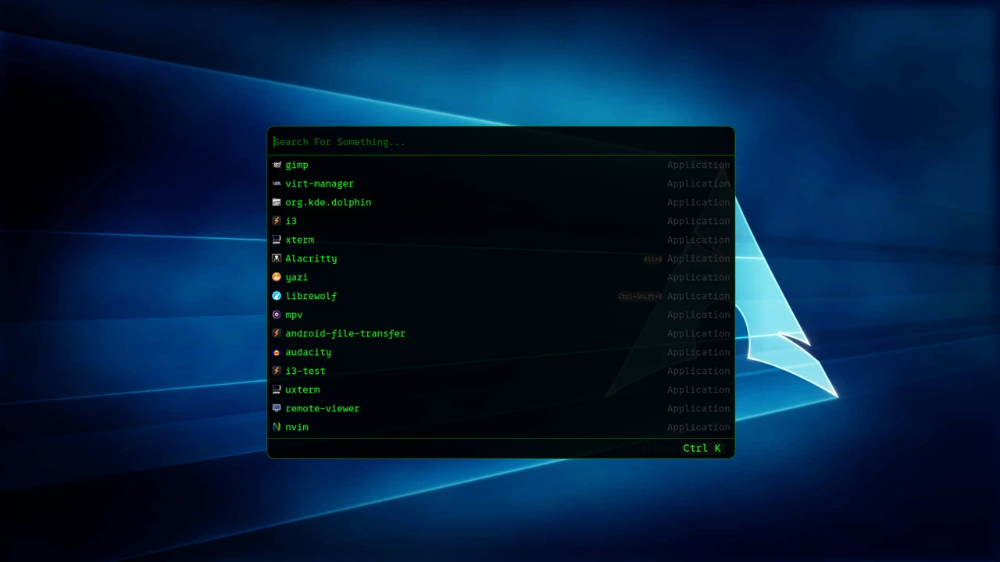
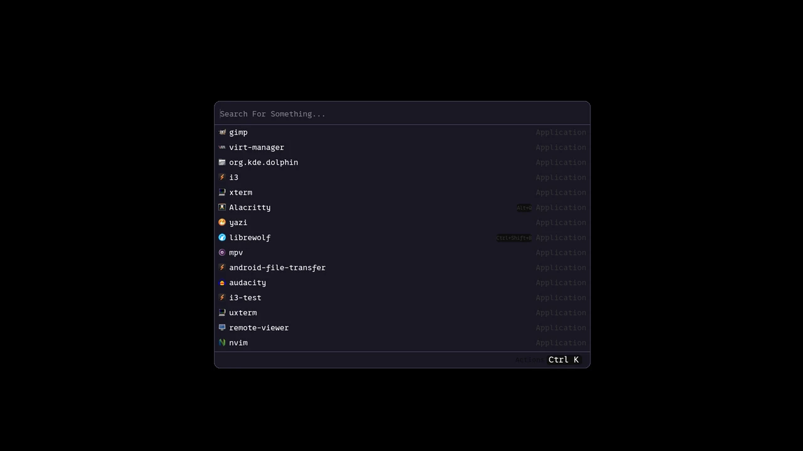
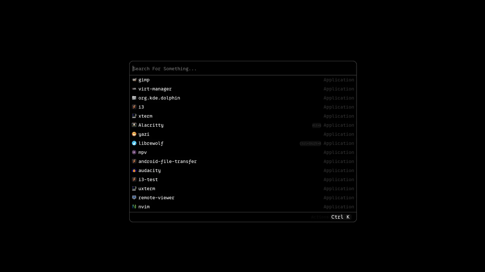
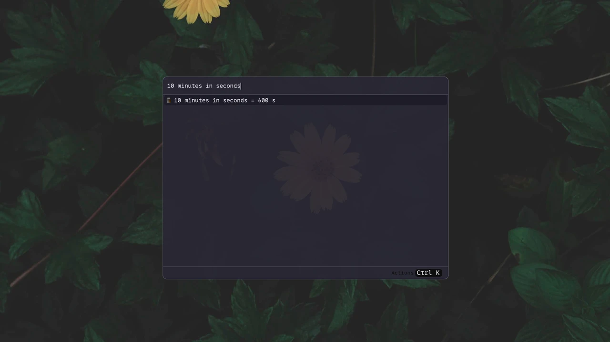
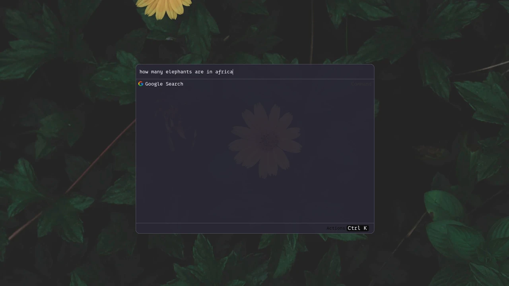
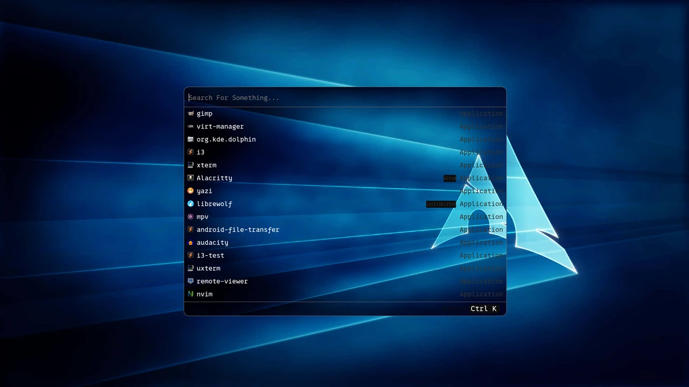
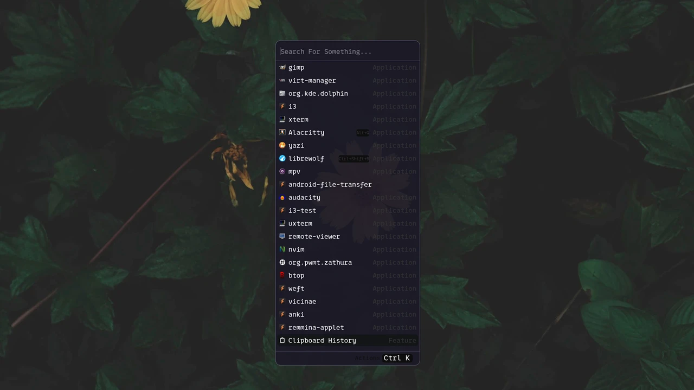
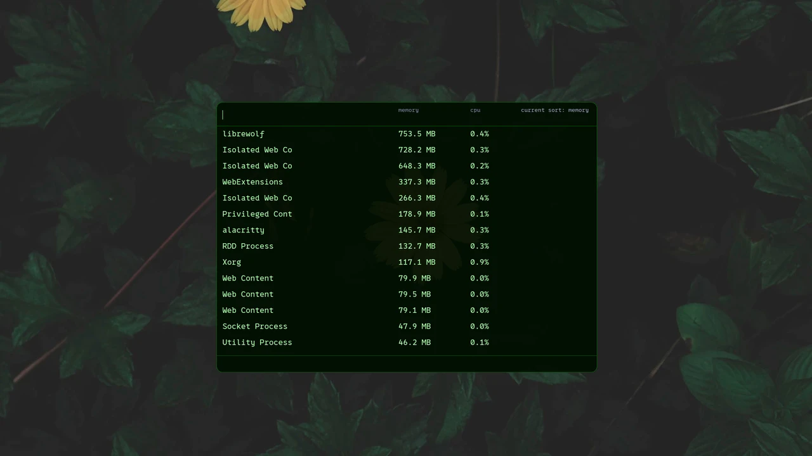

# Skald

<p align="center">
  
</p>

> A native, lightning-fast control center that so happens to have a launcher for Linux and Windows.

Skald is a native system control center. It is written entirely in C, boots instantly, uses very little RAM, and talks directly to your window manager. It's not just a launcher; you can do much more.

## Why I made Skald

On Linux I ran a launcher (rofi), a key remapper (keyd) and a clipboard manager
(CopyQ). On Windows I needed three more apps that did the same jobs, with
different configs and different quirks. I wanted one tool that does all of it
and works the same on both.

Skald is that idea: one small native app, extended through features you add or
remove, with the same feature code running on Linux and Windows. That's the
goal. It's early, so expect rough edges.

## Important Notice

> **Skald is an engine, not a finished setup.** It provides the pieces (global
> hotkeys, key remapping, clipboard access, overlays, widget slots, a feature
> loader), but a fresh install ships with **no widgets and no remaps**. You add
> what you want as features. Out of the box you get the control center:
> launcher, calculator, hotkey and alias registration.
> This is temporary: it's a result of early development and will be improved in the future.

> **Looking for example features?** See [skald-features](https://github.com/soapant/skald-features),
> the features I use daily in my own workflow. They're a good reference for
> writing your own. Since the API is unstable, they may break between versions.

## Why Skald?

- **Modular by Design:** The core is tiny. Everything else is a feature: a compiled C module.
- **Window Manager Native:** Deep integration with X11, Wayland (Sway/Hyprland), and Windows.
- **No Runtime Dependencies:** A release runs without installing anything. (For now, writing or installing features needs a C compiler.)

> ⚠️ **Early Development Warning:**
> Skald is evolving rapidly. The public API (`skapi.h`) is currently **unstable** and changes frequently. If you write your own features right now, be prepared to update your code often as the API matures. After the stable release, Skald will maintain backwards compatibility.
>
> If you are a C developer and want to help build the GUI or refine the features or just help in general, see [CONTRIBUTING.md](CONTRIBUTING.md).

## Screenshots

### Themes

<table>
  <tr>
    <td align="center"><br><sub>Rose Pine</sub></td>
    <td align="center"><br><sub>Modus Vivendi</sub></td>
  </tr>
</table>

### What it does out of the box

<table>
  <tr>
    <td align="center"><br><sub>Built-in calculator</sub></td>
    <td align="center"><br><sub>Web search when nothing matches</sub></td>
  </tr>
</table>

### Backgrounds and window sizes

<table>
  <tr>
    <td align="center"><br><sub>Matching background</sub></td>
    <td align="center"><br><sub>Tall window</sub></td>
  </tr>
</table>

### Example feature: process killer



*An example feature (not included by default) showing system information, running processes, and their CPU and memory usage.*

## Build System

Skald uses **Nob** (a single-header build system by [Tsoding](https://github.com/tsoding/nob.h)). You only need to compile the build tool once.

**On Linux and Windows:**

```bash
# 1. Compile the build tool
gcc -o nob nob.c

# 2. Run the build
./nob
```

## Quick Start (Linux)

**1. Download and extract**

Download the latest `.tar.gz` from the [Releases page](https://github.com/soapant/skald/releases) and extract it (replace `#.#.#` with the version you downloaded):

```bash
tar -xzf skald-v#.#.#-linux.tar.gz
cd skald-v#.#.#
./skald
```

**2. Grant permissions (crucial for hotkeys/remaps)**

To listen for global hotkeys and handle remappings, your user must be in the `input` group:

```bash
sudo usermod -aG input $USER
```

> ⚠️ **You must log out and log back in (or reboot) for this group change to take effect.** If you skip this, Skald will launch, but your global hotkeys will silently do nothing or work inconsistently.

## Quick Start (Windows)

Download the latest `.zip` from the [Releases page](https://github.com/soapant/skald/releases), extract it, and run `skald.exe`.

## How it Works

Skald is split into two halves: **the Core** and **Features**.

- **The Core (Control Center):** The only hardcoded part of Skald. It handles global hotkeys for Hot Reloading, Aliases, and the feature loader. It acts as the "OS" of the launcher.
- **Features:** Everything else is a `.c` file compiled into a `.so` (Linux) or `.dll` (Windows). If you want a clipboard history, you drop `clipboard_history.c` into the `FeaturePath` folder configured in `config.toml`. If you don't want it, just delete it.
- **Manifests:** Every feature has a `.toml` file in its directory. It stores the feature's name, description, what it provides (via the Capability System), and what dependencies it requires to run (right now most of it is empty will be filled out later on).

## Known Issues (Early Development)

Skald is in active, early development. The following bugs are known and will be addressed in future updates. Please do not open a new issue for these unless you have additional debugging information.

1. **Font Hardcoding:** The UI is currently tuned for the `0xProto Nerd Font`. Using any other font will cause text alignment and offset issues. See [#1](https://github.com/soapant/skald/issues/1).
2. **Wayland Hotkeys and Remaps:** Global hotkeys or remaps may fail to register on certain Wayland compositors (e.g., GNOME) due to security restrictions. Skald is designed primarily for X11 right now. It should work on Wayland, but don't be surprised if it doesn't. See [#2](https://github.com/soapant/skald/issues/2) and [#3](https://github.com/soapant/skald/issues/3).
3. **Windows Text Placement:** Some text (for example in the hotkey registration window) is placed too high on Windows. See [#9](https://github.com/soapant/skald/issues/9).

## 🗺️ Future Plans

- **macOS Support:** Port the platform layer to fully support macOS.
- **Polyglot Features:** Allow features to be written in languages other than C (e.g., Lua, C++, or Rust).
- **Settings GUI:** Build a proper graphical settings menu (currently just an empty feature placeholder).
- **Feature Registry:** A centralized website where users can easily find and download community-made features (like a "Skald Extensions" store), alongside a built-in viewer as a feature inside Skald.

## License

Skald is released under the MIT License (see [LICENSE](LICENSE)). Third-party
software it includes is listed in [THIRD_PARTY_NOTICES.md](THIRD_PARTY_NOTICES.md).
